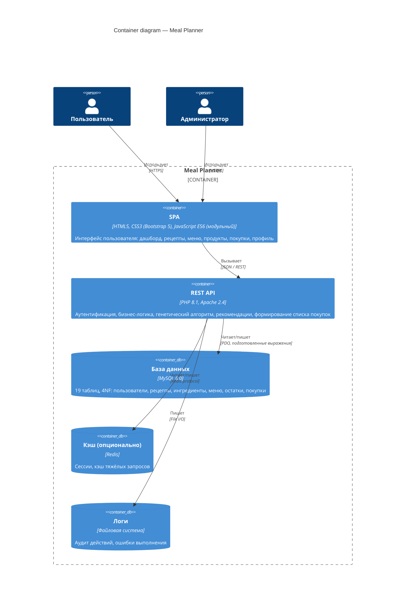

# C4 Level 2 — Containers

Показывает, из каких исполняемых единиц состоит система и как они взаимодействуют.

## Ключевые архитектурные решения (связь с требованиями)

| Решение | Обоснование | Связанное требование |
|---|---|---|
| SPA + REST API | Разделение фронтенда и бэкенда упрощает развитие и тестирование API независимо от UI | `FR-API-01` |
| Подготовленные выражения PDO | Защита от SQL-инъекций | `NFR-SEC-01` |
| `password_hash()` / bcrypt | Безопасное хранение паролей | `NFR-SEC-02` |
| Redis опционально | Кэширование сессий и тяжёлых запросов; без Redis система работоспособна | `NFR-PERF-02` |
| Логи в файловой системе | Аудит действий и диагностика ошибок | `NFR-OBS-01` |

