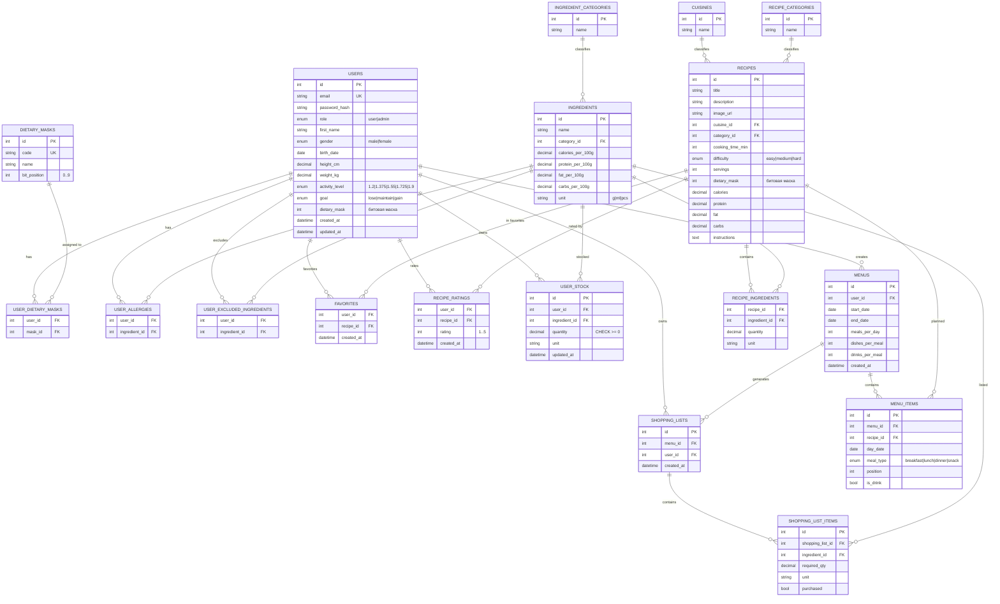

# ERD — модель данных

> Всего — 19 таблиц, нормализация до 4NF.

## Диаграмма

## Описание сущностей

| Таблица | Назначение | Ключевые ограничения |
|---|---|---|
| `users` | Учётные записи, антропометрия, цель, активность, битовая маска ограничений | `email UNIQUE`, `password_hash` — bcrypt |
| `dietary_masks` | Справочник 10 диетических масок | `code UNIQUE`, `bit_position ∈ [0,9]` |
| `user_dietary_masks` | Связь пользователя и активных масок (если не хранится целиком в `users.dietary_mask`) | `[СВЕРИТЬ: вариант хранения — в users или отдельной таблицей]` |
| `ingredients` | Ингредиенты с КБЖУ на 100 г | `calories_per_100g ≥ 0` |
| `ingredient_categories` | Категории ингредиентов (для группировки покупок) | `name UNIQUE` |
| `cuisines` | Кухни мира (для контентной фильтрации) | `name UNIQUE` |
| `recipe_categories` | Категории рецептов (супы, салаты, …) | `name UNIQUE` |
| `recipes` | Рецепты с КБЖУ, инструкцией, ограничениями | `dietary_mask` — битовая маска рецепта |
| `recipe_ingredients` | Состав рецепта | составной PK `(recipe_id, ingredient_id)` |
| `user_allergies` | Аллергены пользователя | составной PK |
| `user_excluded_ingredients` | Исключённые продукты | составной PK |
| `favorites` | Избранные рецепты | составной PK, `created_at` |
| `recipe_ratings` | Оценки рецептов 1–5 (источник для коллаборативной фильтрации) | `rating BETWEEN 1 AND 5` |
| `user_stock` | Остатки продуктов на кухне | `quantity CHECK (quantity >= 0)` |
| `menus` | Сгенерированное меню на период | `start_date ≤ end_date`, период ≤ 31 день `[СВЕРИТЬ]` |
| `menu_items` | Позиции меню | `meal_type`, `position` |
| `shopping_lists` | Список покупок на меню | связь 1:1 с `menus` `[СВЕРИТЬ]` |
| `shopping_list_items` | Позиции списка покупок | `purchased` — отметка покупки |

## Обоснование нормализации до 4NF

- Устранены многозначные зависимости: диетические маски, аллергены и исключённые продукты вынесены в отдельные таблицы связи `user_*`.
- Атрибуты рецепта (название, кухня, категория) отделены от его состава (`recipe_ingredients`), что исключает дублирование КБЖУ ингредиентов при каждом рецепте.
- Оценки пользователей (`recipe_ratings`) не дублируются в `recipes` — это позволяет пересчитывать коллаборативную часть рекомендаций без денормализации.

## Компромиссы

- Большое количество JOIN при выборке меню и списка покупок — цена нормализации. Для целевой нагрузки пет-проекта оправдано; при росте нагрузки можно ввести кэш (Redis) или материализованное представление.
- Битовая маска в `users.dietary_mask` и `recipes.dietary_mask` — осознанная денормализация ради скорости фильтрации, при этом справочник `dietary_masks` сохраняет расширяемость.
